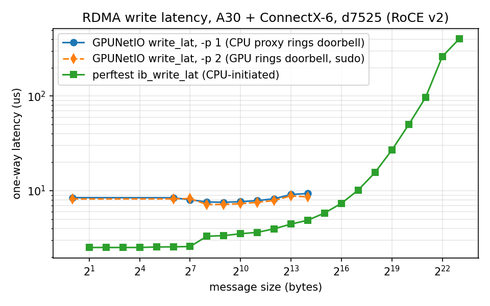
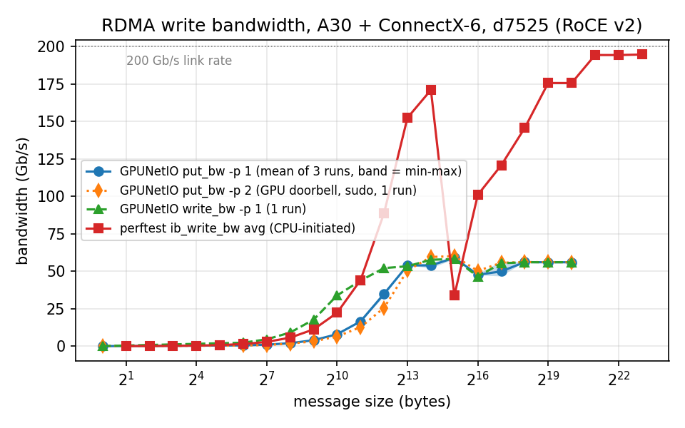

# Part 7: GPU-Initiated RDMA with GPUNetIO on CloudLab

Owner: Fengmao Xie

Experiment `team8-lab8` (project DOCA-GPU, group team8), Wisconsin cluster, 2026-10-24
16:14-20:14 PDT. All command output is in [`results/part7/`](../results/part7/), one folder per
node; the tables and plots below are produced from those logs by `analyze.py`.

## Results at a glance

| Measurement | GPUNetIO (GPU-initiated) | perftest (CPU-initiated) |
|---|---|---|
| One-way latency, smallest message (µs) | **8.46** (1 B, `gpunetio_verbs_write_lat -p 1`); **8.20** with `-p 2` (GPU rings the doorbell, run with sudo) | **2.48** (2 B, `ib_write_lat`, t_typical) |
| Bandwidth at 64 KB (Gbps) | **47.3-47.9** (`gpunetio_verbs_put_bw -p 1`, 3 runs); 50.2 with `-p 2` | **85.3 / 101.0** (`ib_write_bw`, 2 runs) |
| Bandwidth, large messages (Gbps) | ~56 (256 KB-1 MB, all 3 runs) | ~194 (2-8 MB) of the 200 Gb/s link |




Data: [`latency.csv`](../results/part7/analysis/latency.csv),
[`bandwidth.csv`](../results/part7/analysis/bandwidth.csv).

## 7.2 Profile

[`profile.py`](https://github.com/Tr3nt-Xie/ee542-lab8-cloudlab-profile/blob/main/profile.py),
kept alone in a public repository as the handout requires: two bare-metal d7525 nodes, image
`UBUNTU24-64-STD`, one LAN with node0 = 10.10.1.1 and node1 = 10.10.1.2 (/24), and a 200 GB local
blockstore mounted at `/mydata` on each node (182 GB usable) for Docker's data-root.

## 7.3 / 7.6 Node setup

`setup_node.sh` (once) and `after_reboot.sh` (after every boot); logs in
`results/part7/node*/setup_node.log` and `after_reboot-*.txt`.

| Item | What we installed / set | Checked |
|---|---|---|
| NVIDIA driver | `nvidia-driver-pinning-580` + `nvidia-open` (open kernel modules) | **580.196.07** on both A30s |
| CUDA | `cuda-toolkit-13-0` | used to build GPUNetIO (`CUDA_ARCH=80`) and GDRCopy |
| GDRCopy | v2.5.2 in `/opt/mellanox/gdrcopy`, `insmod.sh` | `gdrdrv` loaded, `libgdrapi.so.2.5` |
| Docker | `docker.io` + NVIDIA Container Toolkit, `data-root` = `/mydata/docker` | DOCA image (22.1 GB) pulled to `/mydata` |
| Hugepages | 2,048 x 2 MB | set after each boot |
| Persistence mode | `nvidia-smi -pm 1` | after each boot |
| ACS | cleared with the `setpci ECAP_ACS+0x6.w=0000` loop from the install guide | 71 devices (node0), 67 (node1) |
| IOMMU | `amd_iommu=off iommu=off` on the kernel command line, then reboot | present in `/proc/cmdline` on both |

As the handout warned, the RDMA device came back after the IOMMU change as **`rocep65s0`**;
`common.sh` finds it from the 10.10.1.x interface with `rdma link show`, so no command line
hard-codes it. No firmware was flashed and `mlxconfig` was not used.

One practical issue: the first SSH attempt failed with `Permission denied (publickey)` because
this laptop's key had not been added to the CloudLab account; adding it on CloudLab did not reach
the already-running nodes within a few minutes, so the key was appended to
`~/.ssh/authorized_keys` through each node's web shell.

## 7.4 Hardware

`results/part7/node*/after_reboot-*.txt`. Both nodes are identical where it matters:

| | node0 | node1 |
|---|---|---|
| 10.10.1.x interface | `enp65s0np0`, 10.10.1.1 | `enp65s0np0`, 10.10.1.2 |
| NIC on that interface | ConnectX-6 (MT28908) at **41:00.0**, `mlx5_core`, firmware **20.43.1014**, link **200 Gb/s** | same |
| RDMA device | `rocep65s0`, port 1 ACTIVE / LINK_UP | same |
| GPU | NVIDIA A30 at **25:00.0** | same |
| Other NVIDIA NICs | BlueField-2 (integrated ConnectX-6 Dx) at e2:00.x, ports not cabled | none |
| Kernel | 6.8.0-147-generic (Ubuntu 24.04.5) | same |
| `nvidia-smi topo -m`, GPU0-NIC0 | **NODE** | **NODE** |

`NODE` means the path between the GPU and the NIC crosses the link between two PCIe host
bridges inside one NUMA node. The GPUNetIO installation guide recommends `PIX` or `PXB` (at most
a PCIe switch between them) and says to avoid `NODE` and `SYS`. Compared with the Part 6 cloud
instance (AWS, Tesla T4): it has no ConnectX or BlueField device and no RDMA device, so neither
GPUNetIO path can start there; the exact NIC model and topology are in the Part 6 logs.

## 7.5 `gpunetio_simple_receive` on the d7525

`simple_receive.sh`, log `results/part7/node0/7.5_simple_receive.txt`.

**First attempt: CUDA error 803.** The sample built, then stopped at
`CUDA initialization failed: system has unsupported display driver / cuda driver combination`
(log kept as `7.5_simple_receive_first_try_cuda803.txt`). Inside the container
`LD_LIBRARY_PATH` lists `/usr/local/cuda-13/compat`, which holds the image's forward-compatibility
`libcuda.so.580.178.04`, ahead of the host driver's `libcuda` (580.196.07) mounted by the NVIDIA
runtime. Loading the older compat user-space library against the newer kernel driver is a driver
mismatch. `simple_receive.sh` now removes the `compat` directory from `LD_LIBRARY_PATH` before
running the sample.

**Second attempt: stops creating the DOCA Flow port**, as the handout describes:

```
FW failed to execute general PRM command=0x100, status=BAD_PARAM_ERR (0x3) with syndrome=0x77ad2a
Query devx HCA capabilities with op_mod=0x37 failed. err=DOCA_ERROR_DRIVER
Failed to query WQE based flow table capabilities.
Failed to get hws cap
failed creating doca flow port - port creation failed
```

The sample steers the UDP packets into its GPU receive queue with DOCA Flow **hardware steering
(HWS)**. Starting the port, DOCA queries the NIC for its WQE-based flow-table capabilities
(QUERY_HCA_CAP, op_mod 0x37), and the ConnectX-6 firmware rejects the query with BAD_PARAM. The
GPUNetIO installation guide lists ConnectX-6 Dx or newer (ConnectX-7, BlueField-2/3) for this
Ethernet receive path; the card cabled to the experiment LAN is a plain ConnectX-6, so the GPU
Ethernet receive path cannot run on these nodes. node0's BlueField-2 would qualify, but its ports
are not cabled. RDMA does not need HWS, so Steps 7.8-7.10 run on the same ConnectX-6.

## 7.8 GPU-to-GPU latency

`gpunetio_verbs_write_lat -g 25:00.0 -d rocep65s0 -l 3 -p 1`, server on node0, client on node1.
The log shows `doca_gpu_verbs_export_qp(): Enabling CPU proxy mode`: the CUDA kernel builds the
RDMA write requests and the NIC moves the data out of GPU memory, while a CPU thread rings the
NIC doorbell for the GPU.

| Bytes | 1 | 64 | 256 | 1 K | 4 K | 8 K | 16 K |
|---|---|---|---|---|---|---|---|
| One-way (µs) | 8.46 | 8.44 | 7.62 | 7.67 | 8.24 | 9.14 | 9.36 |

**`-p 2` (the GPU rings the doorbell itself), first run without sudo: failed** on both nodes,
as in the handout:

```
doca_gpu_verbs_export_uar(): Function cudaHostRegister (err 800) failed on addr 0x7ad309abf800 size 8
doca_gpu_verbs_export_qp(): Can't export UAR to GPU.
doca_gpu_verbs_create_qp_hl(): Failed to create GPU verbs QP
```

To ring the doorbell, a GPU thread has to store to the NIC's UAR: an 8-byte doorbell register in
the NIC's PCIe BAR (memory-mapped I/O). GPUNetIO makes that page visible to the GPU with
`cudaHostRegister` on the MMIO address, and CUDA refused with error 800 (operation not
permitted).

**What the GPU needs, and the fix.** The GPUNetIO installation guide ("Running without Root
Privileges") says the Verbs/RDMA samples run without sudo only if the NVIDIA driver has
`NVreg_RegistryDwords="PeerMappingOverride=1;"` set; otherwise they need root. Our first runs
were as a normal user. Run with **sudo**, the same `-p 2` command worked on both nodes: the log
shows `create_uar(): Created UAR with type NONCACHE_DEDICATED`, no "Enabling CPU proxy mode", and
the sample finished successfully (`lat_p2_sudo_*.txt`). So the GPU can ring the doorbell on these
nodes; it needs permission to map the NIC's doorbell page into its address space, through root
privileges or the `PeerMappingOverride` driver option. (`-p 0`, AUTO, was not run: per the
handout it hangs here because the examples start the proxy thread only with `-p 1`.)

| Bytes | 1 | 64 | 256 | 1 K | 4 K | 16 K |
|---|---|---|---|---|---|---|
| `-p 1`, user (µs) | 8.46 | 8.44 | 7.62 | 7.67 | 8.24 | 9.36 |
| `-p 1`, sudo (µs) | 8.48 | 7.93 | - | - | 8.27 | 9.43 |
| **`-p 2`, sudo (µs)** | **8.20** | **8.22** | **7.16** | **7.30** | **7.90** | **8.61** |

Letting the GPU ring the doorbell saves only about **0.3-0.5 µs**, and sudo by itself changes
nothing for `-p 1` (8.48 vs 8.46 µs).

## 7.9 GPU-to-GPU bandwidth

`gpunetio_verbs_put_bw ... -l 3 -p 1` (3 runs) and `gpunetio_verbs_write_bw ... -p 1` (GID 0,
because it rejects `-l`). In every run the server, stopped with Ctrl+C after the client finished,
printed `Validation successfull! Data received correctly from client`.

| Bytes | put_bw run 1 / 2 / 3 (Gbps) | write_bw (Gbps) |
|---|---|---|
| 64 | 0.50 / 0.52 / 0.47 | 2.31 |
| 4 K | 35.4 / 36.1 / 33.0 | 52.1 |
| 32 K | 59.5 / 57.9 / 59.4 | 58.2 |
| **64 K** | **47.3 / 47.8 / 47.8** | **46.5** |
| 1 M | 56.0 / 56.0 / 56.0 | 56.0 |

One more put_bw run with `-p 2` under sudo (`put_bw_p2_sudo_*.txt`, validated): 0.78 Mpps for
small messages, 50.2 Gb/s at 64 KB, 56.0 Gb/s at 1 MB, so ringing the doorbell from the GPU
neither raises the plateau nor the small-message rate here.

Message rate for small messages: put_bw 0.93-1.00 Mpps, write_bw about 4.4 Mpps. The two
examples issue work differently in the kernel (put_bw: 2 blocks x 256 threads, thread scope);
we report the difference without attributing it to a specific mechanism.

Observations: bandwidth levels off at about **56 Gb/s** from 256 KB in all runs, well below the
200 Gb/s link, and **64 KB is lower than both 32 KB and 128 KB-1 MB in all four GPUNetIO runs**
(47-48 Gb/s), so it is a repeatable feature of this setup rather than noise. We did not identify
its cause.

## 7.10 CPU-initiated baseline (perftest)

`ib_write_lat -d rocep65s0 -x 3` and `ib_write_bw -d rocep65s0 -x 3 --report_gbits` (GID index 3
= RoCE v2 with the IPv4 address, the same as `-l 3` above), then the same with `-a` for every
message size. Data in CPU memory, posted by the CPU.

- Latency: **2.48 µs** typical at 2 B (min 2.43, 99% 2.57); 2.5 µs up to 128 B (inline data,
  max 220 B), 3.3-4.0 µs for 256 B-4 KB, 7.4 µs at 64 KB.
- Bandwidth at 64 KB: **85.3 Gb/s** (default run, peak 88.0) and **101.0 Gb/s** in the `-a`
  sweep; up to **194 Gb/s** at 2-8 MB. perftest warned "CPU Frequency is not max" during the
  sweep, and single points vary (32 KB fell to 33.9 Gb/s average in the sweep), so individual
  perftest points should be read with that variability in mind.

## Why the two columns differ

**Where the data is.** GPUNetIO's buffers are in GPU memory: the NIC reads them with PCIe
peer-to-peer DMA from the A30, and here that path crosses two host bridges (`NODE`). perftest's
buffers are in CPU memory, which the NIC reads through its own root port. The GPU path levels off
at about 56 Gb/s while the CPU path reaches 194 Gb/s on the same NIC and link, which points to the
GPU-NIC peer-to-peer path, rather than the network, as the limit for large messages. We infer
this from the topology and the measurements; we did not measure PCIe throughput directly.

**Which processor tells the NIC to send.** With perftest the CPU builds each request in host
memory, rings the doorbell, and small payloads travel inline in the request. With GPUNetIO the
CUDA kernel builds the request in GPU memory, and the doorbell is rung either by a CPU proxy
thread (`-p 1`) or by the GPU itself (`-p 2`). Our `-p 2` runs show that **who rings the doorbell
is not what makes the GPU path slower here**: removing the CPU proxy cut the smallest-message
latency only from 8.46 to 8.20 µs and did not change the 56 Gb/s plateau. The remaining gap to
perftest (8.2 vs 2.5 µs) is therefore more likely in the GPU side of every operation: the NIC has
to fetch the request and payload from GPU memory and write the completion back to GPU memory over
the same peer-to-peer path, and the GPU thread polls for it. We infer this from the measurements
and the `NODE` topology; we did not trace PCIe transactions.

**What GPU-initiated RDMA still buys.** Even through the proxy, the payload never passes through
CPU memory: there is no host staging copy and no `cudaMemcpy` between GPU and host for the data.
That is the copy Part 5 measures with pinned memory. Our results suggest the next gain would come
from the topology rather than the doorbell: on a platform where the GPU and NIC share a PCIe
switch (`PIX`/`PXB`), as the install guide recommends, the peer-to-peer path would be expected to
narrow both gaps.

## Runbook

On **both** nodes:

```bash
git clone https://github.com/Tr3nt-Xie/CNN-Inference-on-Network-Packets-with-NVIDIA-DOCA.git ~/lab8
cd ~/lab8
bash part7_cloudlab/setup_node.sh 2>&1 | tee ~/setup_node.log   # 7.3 + 7.6 grub
sudo reboot
cd ~/lab8 && bash part7_cloudlab/after_reboot.sh                 # after EVERY reboot: 7.3 per-boot + 7.4
```

node0: `bash part7_cloudlab/pull_doca.sh`, then `bash part7_cloudlab/simple_receive.sh` (7.5).

RDMA tests, server on node0 first, then client on node1 (`rdma.sh server|client TEST [RUN]`):
`lat`, `lat_p2`, `put_bw` (Ctrl+C the server after the client ends), `write_bw` (same), `ib_lat`,
`ib_bw`, `ib_lat_all`, `ib_bw_all`. A third argument numbers repeated runs (`put_bw 2`).

The `-p 2` runs need root (or `PeerMappingOverride=1`, see 7.8). They were run as:

```bash
source ~/lab8/part7_cloudlab/common.sh
# node0 (server), then node1 with "-c 10.10.1.1" appended
sudo env LD_LIBRARY_PATH=$LD_LIBRARY_PATH DOCA_GPUNETIO_LOG=6 $EX/gpunetio_verbs_write_lat -g $GPU_PCI -d $RDEV -l 3 -p 2
sudo env LD_LIBRARY_PATH=$LD_LIBRARY_PATH DOCA_GPUNETIO_LOG=6 $EX/gpunetio_verbs_put_bw    -g $GPU_PCI -d $RDEV -l 3 -p 2
```

Copy the logs off before the experiment ends, then terminate it:

```bash
scp -r <user>@<node0-host>:lab8/results/part7/ ./results/
scp -r <user>@<node1-host>:lab8/results/part7/ ./results/
python3 part7_cloudlab/analyze.py      # tables + plots -> results/part7/analysis/
```

| File | Step | What it does |
|---|---|---|
| `common.sh` | - | Finds the 10.10.1.x interface, its RDMA device, NIC and GPU PCI addresses |
| `setup_node.sh` | 7.3, 7.6 | Driver 580 (open), CUDA 13.0, Docker + NVIDIA runtime on `/mydata`, GPUNetIO build, IOMMU off |
| `after_reboot.sh` | 7.3, 7.4 | Persistence, hugepages, GDRCopy + gdrdrv, ACS off, hardware report |
| `pull_doca.sh` | 7.5 | Pulls the DOCA image in the background |
| `simple_receive.sh` | 7.5 | Builds and runs `gpunetio_simple_receive` in the DOCA container |
| `rdma.sh` | 7.8-7.10 | One GPUNetIO or perftest test as server or client, output saved per run |
| `analyze.py` | 7.10 | Parses the client logs into CSV and the two plots |
